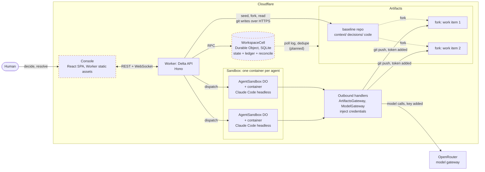

# Delta Convergence

**Git tells you when two agents changed the same lines. Delta Convergence tells you when two agents are building from different decisions, and won't let the stale one merge.**

Delta Convergence is a control plane that keeps concurrent humans and agents working from the same *meaning*. When an accepted decision changes mid-flight, it finds the work that relied on the old version, blocks that work from merging, and drives a human-approved reconciliation. The referee is deterministic rules. It makes no model calls.

Built for the Cloudflare ["Build the next GitHub"](https://www.cloudflare.com/git-competition/) challenge on Workers, Durable Objects, Sandbox containers and Artifacts.

> **Delta is general, not coding-only.** The engine reconciles *accepted context* against *in-flight work*. Code is one kind of work. A sales forecast, a playbook and a glossary built on the definition of "qualified lead" are another. Both scenarios below run through the same engine with different fixtures.

> **Status: work in progress, 2026-10-12.** The engine, contracts, Artifacts adapter and agent runtime are on `main`. The control loop, console, resolve/promote flow and replay mode are still landing. See [Implemented vs not](#implemented-vs-not) before relying on anything here.

## The problem

Two agents work on the same codebase. One makes the signup form's phone field optional. The other makes the API require it. Each passes its own tests. Git sees no conflict, because nobody touched the same line. Production breaks. They disagreed about what the product is.

The same thing happens outside code. A sales team changes what "qualified lead" means. The Q4 forecast, the SDR playbook and the dashboard were each built on the old definition. Nothing marks them as out of date.

Git versions files. Nothing versions the **accepted decision that governs the work**, or records which work was built on which version.

| Question | Git + CI + PR review | Delta Convergence |
|---|---|---|
| Do the two branches merge cleanly? | Yes | Not its job |
| Do each branch's own tests pass? | Yes | Not its job |
| Which decision version was this branch built on? | Not recorded | Receipt: record, version, hash |
| The decision just changed. Which in-flight work is affected? | Unknown | Stale, with the changed facets named |
| Which work is *not* affected? | Unknown | Left alone, with a reason code |
| Can the stale branch merge? | Yes | No, until a human resolves it |

## How it works

| Concept | What it is |
|---|---|
| **Context record** | A decision or definition: a Markdown file with YAML front-matter in the baseline repo (`context/**.md`). Versioned. Its **facets** are machine-checkable key/value claims, such as `notifications.default: opt-in`. |
| **Receipt** | Proof of what was *delivered* to an agent: record ids, versions and hashes at dispatch. Proves delivery, not understanding. Designed to be written as a **git note** on the agent's fork (`refs/notes/delta`) so any git client can read it. |
| **Staleness** | Facet-level. A new accepted version is diffed against each non-promoted item's receipt. Only items with an accepted dependency on a *changed facet* go stale. A prose-only edit stales nothing (`PROSE_ONLY`). |
| **Claim** | A structured assertion an agent makes about its output (`.delta/claims.json`). Self-reported, so always labelled *agent-asserted, unverified*. |
| **Evidence** | The result of a contract check that **Delta runs** at the fork head. Not agent-reported. A conflict does not depend on the agent being honest about its own claims. |
| **Gate** | Promotion is allowed only if the item is fresh and every required check passes at the current heads, or a human with authority granted a bound, scoped exception. Anything unknown blocks. |
| **Human resolution** | `revalidate` (re-dispatch the agent on new context), `accept-exception` (scoped, with a rationale), or `reject`. Agents cannot resolve. Each resolution is bound to the record version and hash, base commit and fork head. |
| **Ledger** | Append-only and hash-chained. Every observation, effect and refusal is a line, with a reason code. |

### The agents are LLMs; the referee isn't

Models do the work and propose changes. They never authorize anything. Staleness, claim comparison, the gate and the ledger are plain functions of explicit state:

```ts
reconcile(state, event, policy) -> { state, effects }
```

No LLM is required to operate Delta; models propose, rules and humans decide. In this repo, `packages/delta-core` is pure: no I/O, clock, randomness, network or model SDK. `packages/delta-core/src/purity.test.ts` scans the sources for those and fails if any appear.

### Rules

| Rule | Behavior |
|---|---|
| R1 Staleness | Changed facet plus accepted dependency gives `Stale`, `BLOCK_PROMOTION`, `REQUEST_REVIEW`. Prose-only gives `NO_ACTION`. |
| R2 Unaffected | No dependency on a changed facet: untouched, with a reason code. |
| R3 Claim conflict | A claim that differs from the accepted facet, or was based on a superseded one, is a conflict. Missing or malformed claims fail closed (`Uncertain`). |
| R3b Cross-claim | Two live items claiming different values for a subject nothing governs: `Uncertain`. |
| R4 Undeclared reliance | A claim citing a record outside the receipt creates a *proposed* dependency. A human accepts or rejects it. |
| R5 Gate | Fresh and checks passed, or a bound exception. Forks that edit `context/**` are never promotable. |
| R6 Revalidation | New receipt at current versions, diff-aware re-dispatch, loop guard after `maxRevalidations`. |
| R7 Binding | Resolutions are bound to versions, hashes and heads. Promotion is two-phase and re-checks the gate at merge time. |
| R8 Evidence | Contract checks run by Delta at the fork head and again at promote. |
| R9 Idempotency | Events are deduplicated on `(repo, commitSha)`. Commands dedupe on their `Idempotency-Key`. |

Five named invariant tests (`packages/delta-core/src/testing/invariants.ts`) run against both scenarios:

1. unaffected work never changes status
2. prose-only edit stales nothing
3. replayed event yields one ledger entry
4. agent actor cannot resolve
5. chain breaks on any edit

Design choices where the PRD left room are in [`packages/delta-core/DESIGN-NOTES.md`](packages/delta-core/DESIGN-NOTES.md).

## Architecture



Dashed boxes and the dotted poll edge are in progress or planned and are not on `main` yet. The Worker never lets the model key or an Artifacts token into an agent container: the container has no direct internet, and the outbound handlers add credentials only for that fork's git host and the model endpoint. Details: [`docs/agent-runtime.md`](docs/agent-runtime.md).

### Where Workers and Artifacts are used

| Primitive | Use | Where |
|---|---|---|
| **Artifacts** | One baseline repo per scenario, one fork per work item. Read through the binding (`log`, `readFile`, `fork`, `create`). | `apps/worker/src/artifacts/git-write.ts`, `apps/worker/src/smoke.ts` |
| **Artifacts, git over HTTPS** | The binding is read-only, so writes use isomorphic-git with a patched in-memory fs. Tokens go in an auth header, are stripped of their expiry suffix, and are redacted from logs. | `apps/worker/src/artifacts/{git-write,memory-fs,tokens}.ts` |
| **Artifacts, tree diff** | Recursive tree walk to compare a fork with its base. | `apps/worker/src/artifacts/tree-diff.ts` |
| **Workers (Hono)** | Delta API, bearer auth, agent dispatch, repo log and file reads. | `apps/worker/src/index.ts` |
| **Durable Objects** | `WorkspaceCell` (SQLite) is the home for state, ledger and reconcile. `AgentSandbox` runs one agent per work item. | `apps/worker/src/workspace-cell.ts` (skeleton), `apps/worker/src/agents/sandbox.ts` |
| **Sandbox containers** | One container per agent: clone the fork, run the agent, commit as the work item, push. | `apps/worker/container/`, `apps/worker/src/agents/`, `apps/worker/wrangler.jsonc` |
| **Queues** | Not used. Push detection is polling first. | n/a |
| **WebSocket hibernation** | Planned for live console updates. | n/a |

<!-- VERIFY: update this table when the WorkspaceCell store, poller and WebSocket fan-out merge (T-4). Do not list Queues or hibernation unless they ran in the deployed build. -->

### Repo layout

```
packages/contracts/   Zod schemas: records, receipts, claims, evidence, dependencies, resolutions, events, effects
packages/delta-core/  pure reconcile(state, event, policy); rules R1-R9; WebCrypto hash-chained ledger
apps/worker/          Hono API, WorkspaceCell DO, Artifacts adapter, Sandbox agent runtime
apps/console/         React SPA (placeholder on main)
scenarios/            notifications (coding) and sales-ops (knowledge work) fixtures
scripts/              check-overlap.mjs: proves concurrent agent runs against a deployed Worker
docs/                 PRD, agent runtime notes, submission drafts
```

## Two scenarios, one engine

| | **Notifications** (coding) | **Sales-ops** (knowledge work) |
|---|---|---|
| Company | A small TypeScript project-status service | Northwind Field Services, a synthetic company |
| Decision that changes | `notifications` v1 (default-on, immediate) becomes v2 (opt-in, weekly digest) | `qualified-lead` v1 (form fill and 50+ employees) gains a verified budget signal in v2 |
| Affected | WI-2 notification delivery goes stale and conflicts | WI-3 Q4 forecast and WI-4 SDR priorities go stale |
| Unaffected | WI-1 status badges stays fresh | WI-5 activity glossary stays fresh |
| Resolution | Revalidate, then promote | One revalidated, one scoped accept-exception |
| Extra beats | Typo edit stales nothing. 50 seeded items evaluated in one pass | Same engine, no code change |

The knowledge-work domain may change before submission; the point is that it is not code. Fixtures live in `scenarios/`. The engine test [`packages/delta-core/src/scenarios.test.ts`](packages/delta-core/src/scenarios.test.ts) walks both. Seeded work items (`source: seeded`) have no model behind them and are always labelled as seeded.

<!-- VERIFY: console views, live agents and replay of these scenarios depend on T-5, T-6, T-7 and T-8. Re-check this section and the video script against what ships. -->

## Run it

Requires Node 26+ and pnpm 10+.

**Install, typecheck, test.** No network and no keys needed for typecheck and test:

```bash
pnpm install
pnpm -r typecheck
pnpm -r test          # vitest
```

**Worker locally.** `wrangler dev` has no Artifacts emulator, so it talks to the real service and needs a Cloudflare account with Artifacts access:

```bash
cp apps/worker/.dev.vars.example apps/worker/.dev.vars   # set DEV_TOKEN
pnpm --filter worker dev
```

**Deploy** (maintainer machine only). Needs your own Cloudflare account on Workers Paid with Artifacts and Containers access, and Docker to build the container image. Put `CLOUDFLARE_ACCOUNT_ID` in a gitignored `.env`, not in `wrangler.jsonc`.

```bash
wrangler secret put DEV_TOKEN               # bearer token for /api/*
wrangler secret put OPENROUTER_API_KEY      # only for AGENT_MODE=claude
pnpm --filter worker exec wrangler deploy
```

**Agent modes.** `AGENT_MODE=stub` (default) runs a scripted agent and needs no model key. `AGENT_MODE=claude` runs Claude Code headless through OpenRouter; `AGENT_MODEL` pins the model slug. Prove concurrency against a deployed Worker (needs `ENABLE_SMOKE=1`):

```bash
WORKER_URL=https://<your-worker>.workers.dev node scripts/check-overlap.mjs --forks 2 --cleanup
```

Deployed demo and video: not published yet.
<!-- VERIFY: add the deployed URL, video link and the exact fresh-clone steps after T-8 and T-12. Replay mode (run with no credentials) is planned; do not document it until it ships. -->

## What Delta does not do

- **It only gates actions that flow through it.** An agent or person with their own repo credentials can walk around it. The Worker is meant to be the single writer to the baseline.
- **It checks declared facets and claims only.** It does not understand arbitrary text. If a dependency is neither declared nor claimed, Delta does not know about it.
- **A receipt proves delivery, not understanding.** It says what an agent was handed, not that it read or followed it.
- **Stale does not mean wrong.** It means built on a superseded version. A human decides.
- **Claims are self-reported.** Only Delta-run contract checks are verified, and only for what the check asserts.
- **Identity is simulated.** The demo uses a bearer token and a labelled demo identity. In the solo demo one person holds both exception and promote authority.
- **It does not auto-resolve consequential conflicts**, replace Git or Artifacts, or build a knowledge graph.

## Implemented vs not

As of 2026-10-12. "Built" means code on `main` with the named tests passing. Nothing here is "verified" beyond what the Notes column states.

| Item | Status | Backed by / notes |
|---|---|---|
| Zod contracts, record parser (fail closed) | Built | `packages/contracts` tests |
| `reconcile`, rules R1-R9 and R3b, dry-run gate | Built | `packages/delta-core` tests, five named invariants, both scenarios |
| Purity: no I/O, clock, randomness, network or model SDK in `delta-core` | Built | `purity.test.ts` |
| Hash-chained ledger (WebCrypto) | Built | `ledger.test.ts`, "chain breaks on any edit" |
| Both scenario fixtures and engine walk-throughs | Built | `scenarios.test.ts` |
| Fan-out over seeded items (engine level) | Built | `fanout.test.ts` (50 items; 300-item timing test). No console strip yet |
| Worker, Artifacts seed and fork, git writes over HTTPS | Built | `apps/worker` tests. Live smoke test against Artifacts on 2026-10-12 per commit history |
| Sandbox agent runtime, stub agent, credential isolation | Built | `apps/worker/src/agents/*` tests. Two- and four-way concurrent runs reported live on 2026-10-12 per commit history |
| Claude agents via OpenRouter (`AGENT_MODE=claude`) | Wired, not yet shown in a recorded run | Config and gateway in place <!-- VERIFY: confirm a real Claude run completed against a fork before claiming this --> |
| Receipts as git notes | Serializer built; not yet written to forks | `receipt-note.ts` and tests <!-- VERIFY: update when the note is pushed and readable with `git notes --ref=delta show` --> |
| `WorkspaceCell` store: state, ledger persistence, reconcile in the DO | In progress | Skeleton only on `main` <!-- VERIFY: control loop (T-4) --> |
| Push detection: poller, dedupe, event pipeline | In progress | Polling first <!-- VERIFY: control loop (T-4) --> |
| Queues push events | Not built | Optional upgrade over polling |
| Live console updates over WebSocket | In progress | <!-- VERIFY: console and WebSocket (T-5) --> |
| Convergence Console (work graph, inspector, why panel) | In progress | Placeholder package on `main` <!-- VERIFY: console (T-5) --> |
| Delta-run contract check runner (R8) at fork head | In progress | Core consumes `Evidence`; the runner is not wired <!-- VERIFY: T-4 or T-6 --> |
| Resolve, revalidate re-dispatch, promote and merge via the Worker | In progress | Gate and binding logic are in `delta-core`; HTTP endpoints and merge are not <!-- VERIFY: resolve/promote (T-6) --> |
| Scenario B (sales-ops) end to end | Seeded or replay first | Fixtures built; live agents undecided |
| Replay mode | In progress | <!-- VERIFY: replay mode (T-8). Replay segments must be labelled replay --> |
| Local agent runner fallback (`apps/runner`) | Not built | Only if Sandbox fails |
| Deployed URL, demo video | Not yet | |
| Authority and approvals as first-class objects, MCP server, AI dependency inference | Not built | After the contest |

Try Together / what-if (see what would go stale under a proposed decision before accepting it) was considered and cut.

## Why not X?

These were compared from each tool's published documentation, not tested hands-on. Corrections welcome.

| Alternative | What it does well | What it appears not to track |
|---|---|---|
| **Git + CI + PR review** | Line-level conflicts, per-branch tests, review history. | Which decision version a branch was built on. Two branches can merge clean, pass their tests, and contradict a changed decision. |
| **Spec tools + CI** (for example [Spec Kit](https://github.com/github/spec-kit)) | Turn a spec into a plan and tasks; CI checks code against it at one moment. | Which in-flight work was built on which spec version, and what to do when the spec changes mid-flight. |
| **Parallel-agent tools + PRs** | Run many agents on isolated branches or worktrees, then review diffs. | Whether the agents were building from the same decision. Merging is the gate, not meaning. |
| **Broadcast notifications** | Tell everyone something changed. | Who is affected, who is not, and no blocking. Delta leaves unaffected work alone and gates the affected work. |
| **[AGENTS.md](https://agents.md)** | A convention for giving agents project instructions. | It is read at start, with no receipt of what was delivered, no staleness, no gate. Delta uses it as the carrier for the agent protocol. |

## Prior art and credit

- **Kubernetes controllers.** The reconcile-desired-against-actual shape. Delta compares accepted context with in-flight work instead of infrastructure.
- **Git and [Radicle](https://radicle.xyz).** Provenance of who changed what and who authorized it, as described in their public docs. Delta tracks a different thing: which work depended on which accepted meaning. <!-- VERIFY: Radicle description against its docs before submission -->
- **Requirements traceability and "suspect links".** Traceability tools flag downstream items when an upstream requirement changes. <!-- TODO(prior-art): credit and comparison pending the prior-art research run. Fill in tools and wording; do not claim novelty over this line of work. -->
- **Own earlier spikes.** The Artifacts in-memory fs for isomorphic-git, ledger hash chain and graph layout patterns are the author's own prior code, reused. The commit history of this repo stays inside the contest window.

## Beyond the contest

Not built: authority and approvals as first-class objects, cross-org authority boundaries, an MCP server so any agent can fetch its receipt and post claims, AI adapters for dependency inference and claim extraction, a what-if canvas.

## License

[MIT](LICENSE)
