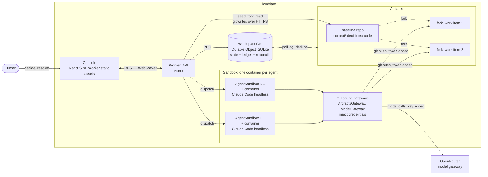

# Delta Convergence

A decision shouldn't just be written down. The system should know what depends on it.

It works like a lockfile for decisions. Each agent's context is pinned to the exact version of every decision it was given, so when one changes, you know exactly whose work was built on the old version. That work gets blocked from merging, even if it sits in a different file and git merges it clean, until a named human revalidates it. Everything else stays green, and no model makes any of those calls.

## Try it in 60 seconds

**A. Open the deployed console in replay mode.** No account, no keys:

<https://delta-convergence.andrew-8c6.workers.dev/?mock=1>

Replay plays a scripted story in your browser through the same rule code the server runs, and the header says "Mock · replay" the whole time. Use the tabs at the top: **Notifications**, **Larkhaven County Shelter**, **Our own build**. Press the right arrow key (or **Next**) to step through each story.

**B. Run it locally.** Replay needs no Cloudflare account and no keys.

```bash
pnpm install
pnpm --filter console dev     # open http://localhost:5173/?mock=1
```

To see the console served the way it ships, as static assets from the Worker:

```bash
pnpm install
pnpm build:console
cd apps/worker && npx wrangler dev     # open http://localhost:8787/?mock=1
```

Heads up on that second route: `wrangler dev` has no local emulator for Cloudflare Artifacts, so it contacts Cloudflare and needs a `wrangler login`, even though replay itself uses no account data. The first route needs nothing. Live mode (real repos, real agents) needs an Artifacts account and a bearer token: see [Running live](#running-live).

Built for the Cloudflare ["Build the next GitHub"](https://www.cloudflare.com/git-competition/) challenge on Workers, Durable Objects, Artifacts and Sandbox containers.

<!-- TODO(andrew): AI-assisted-code disclosure line. Your call on whether and how to say it. -->

## The problem

Two agents work on the same codebase. The decision owner decides that notifications should be opt-in with a weekly digest, where the old rule was on by default and immediate. While that change lands, one agent is already building notification delivery in its own file, on the old default. The other is building status badges, which have nothing to do with notifications.

Git sees no conflict, because nobody touched the same line. The delivery branch merges clean and still ships the wrong behavior. The status badge branch is fine, and nothing should slow it down.

Git versions files. Nothing versions the **accepted decision that governs the work**, or records which work was built on which version. Delta Convergence adds that record. When an agent starts, it is handed a **receipt**: a record of exactly which decision versions it was given, with a hash of each. When a decision changes, the receipts say whose work is affected.

The same thing happens outside code. Take a synthetic flood shelter, in a fictional place called Larkhaven County. The intake policy changes: pets are now admitted if crated, and ID is no longer required. A front-desk script, the door signage and a volunteer briefing were each drafted from the old policy, and nothing marks them out of date. The supply list and the shift schedule never depended on those rules, and should be left alone.

| Question | Git + CI + PR review | Delta Convergence |
|---|---|---|
| Do the two branches merge cleanly? | Yes | Not its job. It does not replace the merge. |
| Does each branch pass its own checks? | Yes | Not its job. |
| Which decision version was this work built on? | Not recorded | Recorded in the receipt: record, version, hash. |
| The decision just changed. Which in-flight work is affected? | Unknown | The work that declared a dependency on what changed, with the changed fields named. |
| Which work is not affected? | Unknown | Left alone, with a reason recorded. |
| Can the stale work merge? | Yes | Not through Delta Convergence, until a human resolves it. |

The last row has a catch. It only holds for work that goes through Delta Convergence. See [Honest limits](#honest-limits).

## How it works

Terms, each in one sentence:

| Term | Meaning |
|---|---|
| **Decision record** (context record) | A Markdown file with YAML front matter in the baseline repo (`context/**.md`) that states an accepted decision. It is versioned. |
| **Facet** | One checkable key and value inside a decision record, such as `notifications.default: opt-in`. |
| **Receipt** | The record of which decision versions and hashes an agent was handed. It proves delivery, not that the agent read or followed them. It is also written as a git note on the agent's fork (`refs/notes/delta`) when a revalidation is dispatched. |
| **Stale** | A work item whose receipt points at a version of a facet it depends on that has since changed. Stale is not the same as wrong. |
| **Claim** | A structured statement an agent makes about its own output (`.delta/claims.json`). It is self-reported, so the console labels it "agent-asserted, unverified". |
| **Evidence** | The result of a check that Delta Convergence itself runs on the pushed files. It does not depend on the agent being honest. |
| **Gate** | The test for promotion: the work is fresh and its required checks passed at the current heads, or a human holding the right authority granted a scoped exception. Anything unknown blocks. |
| **Resolution** | A human decision on stale work: revalidate (re-run the agent on the new decision), accept an exception (scoped, with a rationale), or reject. Agents cannot resolve. |
| **Ledger** | An append-only, hash-chained log. Every observation, effect and refusal is a line, with a reason code. |
| **Reconcile** | The function that takes the current state and a new event and returns the new state plus a list of effects. Section below. |

The flow:

1. Decisions live as versioned records in a baseline repo. Each work item gets its own fork of that repo.
2. An agent is handed a receipt and works on its fork.
3. When someone commits a new decision version to the baseline, the system compares the changed facets with each item's receipt and declared dependencies.
4. Work that depends on a changed facet goes stale and is blocked from promotion. Work that does not is left alone, with a reason.
5. A named human resolves the stale work. Revalidation re-runs the agent with the old and new decision side by side. Promotion merges only if the gate passes at the current heads.

### The agents are models; the referee isn't

Models do the work and propose changes. They never authorize anything. Staleness, claim comparison, the gate and the ledger are plain functions of explicit state:

```ts
reconcile(state, event, policy) -> { state, effects }
```

No LLM is required to operate Delta Convergence. In this repo, `packages/delta-core` is pure: no I/O, clock, randomness, network or model SDK. `packages/delta-core/src/purity.test.ts` scans the sources for those and fails if any appear.

### The rules, in plain words

| Rule | What it does |
|---|---|
| R1 Staleness | If a facet that an item depends on has changed, the item is stale, promotion is blocked and review is requested. A wording-only edit changes no facet and stales nothing (`PROSE_ONLY`). |
| R2 Unaffected | An item with no dependency on a changed facet is left alone, and the ledger says why. |
| R3 Claim conflict | A claim that disagrees with the accepted facet, or that cites a superseded version of a facet that changed, is a conflict. Missing or malformed claims fail closed (`Uncertain`). |
| R3b Cross-claim | Two live items claiming different values for a subject no decision governs are marked `Uncertain`. |
| R4 Undeclared reliance | A claim that cites a decision outside the item's receipt creates a proposed dependency. A human accepts or rejects it. |
| R5 Gate | Promotion needs a fresh item with passing required checks, or a bound exception. A fork that edits `context/**` can never be promoted. |
| R6 Revalidation | Revalidating issues a new receipt at the current versions and re-runs the agent. After `maxRevalidations` loops, it asks for review instead. |
| R7 Binding | A resolution is bound to the decision version and hash, the base commit and the fork head. Promotion re-checks the gate at merge time. |
| R8 Evidence | Checks are run by Delta Convergence on the pushed files, not reported by the agent. |
| R9 Idempotency | A repeated event (same repo and commit) produces one ledger line. Mutating requests carry an `Idempotency-Key`. |

Five named invariant tests (`packages/delta-core/src/testing/invariants.ts`, run by `invariants.test.ts`) run against the fixtures:

1. unaffected work never changes status
2. prose-only edit stales nothing
3. replayed event yields one ledger entry
4. agent actor cannot resolve
5. chain breaks on any edit

Design choices where the spec left room are in [`packages/delta-core/DESIGN-NOTES.md`](packages/delta-core/DESIGN-NOTES.md). The full spec is [`docs/PRD.md`](docs/PRD.md). The control loop is described in [`docs/control-loop.md`](docs/control-loop.md).

## Scenarios

All of these run through the same engine, with different fixtures.

| | **Notifications** (coding) | **Larkhaven County shelter** (knowledge work) | **Our own build** |
|---|---|---|---|
| What it is | A small TypeScript status service | A fictional county's flood shelter, five drafts from one intake policy | This repo's own decisions, governed by Delta Convergence |
| Decision that changes | `notifications` v1 (on by default, immediate) becomes v2 (opt-in, weekly digest) | `shelter-intake-policy` v1 to v2 (pets, ID), then v3 (capacity note) | Six decision records, for example what counts as a contract test, or the name of the fictional county |
| Goes stale | WI-2 notification delivery | Front-desk script, door signage, volunteer briefing | Whatever declared a dependency on the changed facet |
| Left alone | WI-1 status badges | Supply list, shift schedule | The rest, including a negative control |
| Resolution | Revalidate, then promote | Script and briefing revalidated; signage gets a scoped exception that lapses when the policy moves to v3 | Humans resolve outside the console |
| Where it runs | Console replay; live on the Worker with stub agents | Console replay and engine tests; also live on the Worker with two real agents (replay is the fallback) | Console replay, plus a live cell |
| Extra beats | A typo edit stales nothing. A fan-out of 40 seeded items in one pass | Exception lapse (`EXCEPTION_LAPSED`) | Wording-only edit |

**Notifications** is the main demo. Two agents run at once on separate forks, a decision changes mid-flight, delivery goes stale and badges stay green. The delivery work is blocked even though a plain git merge of both forks is clean.

**Larkhaven County shelter** is a synthetic scenario, not operational guidance. The county, its flood and its volunteer network are invented, and nothing in it should be used as an alert, as eligibility guidance or as an operating instruction. The console keeps that note on screen while it is open. The console replays it from fixtures, engine tests walk through it, and it has also been run live with real agents on the deployed Worker (below). Details: [`scenarios/shelter-intake/README.md`](scenarios/shelter-intake/README.md).

**Our own build** is Delta Convergence governing its own build. The replay (`?mock=1&scenario=delta-convergence-build`) reconstructs our decisions from this repo's git history, and the console says it is retrofitted: nothing in it was detected at the time. A live cell has recorded real decisions since Oct 13. Its work items are pointers to real pull requests, it never dispatches an agent and never merges, and humans resolve outside the console. Details and the commands: [`docs/dogfooding.md`](docs/dogfooding.md).

Seeded work items (`source: seeded`) have no model behind them and are always labelled as seeded. A fourth fixture, Northwind sales ops, is still in the repo and in the engine tests, and is hidden from the console tabs (`?scenario=sales-ops` opens it in replay).

The shelter act also runs live on the deployed Worker, with two real model agents running at once in Sandbox containers on separate Artifacts forks: one writes the front-desk script (SH-1, relies on `pets` and `id_required`), one the supply list (SH-2, relies on `capacity_note`), and the decision owner changes the intake policy while they work (v2: crated pets admitted, ID not required). In the verified run on Oct 13, SH-1 went stale and was blocked within about 64 ms of v2 being accepted, in a different file from the record that changed. SH-2 stayed green and promoted. SH-1 was revalidated by a rerun and then promoted, and the ledger hash chain verified. The agents in that run were GLM, through OpenRouter. Replay remains as the fallback.

```bash
WORKER_URL=https://<your-worker>.workers.dev DEV_TOKEN=... node scripts/check-live-shelter.mjs
```

`--cell shelter-intake-demo --stop-before-revalidate` stages it instead. It needs `ENABLE_SMOKE=1` and `AGENT_MODE=claude`. See [docs/shelter-live.md](docs/shelter-live.md).

## Architecture



In words:

- **Workers (Hono)** serve the API behind a bearer guard and serve the console as static assets.
- **A `WorkspaceCell` Durable Object per scenario**, backed by SQLite, holds the state, the hash-chained ledger and the dedupe table. It runs `reconcile` one event at a time, polls the Artifacts repos on an alarm, and fans events out to consoles over hibernating WebSockets.
- **Artifacts** holds one baseline repo per scenario and one fork per work item. The binding only reads and manages repos and tokens, so writes go over git on HTTPS with isomorphic-git and a patched in-memory filesystem. Receipts are written as git notes when a revalidation is dispatched.
- **Sandbox containers**, one per agent, are owned by an `AgentSandbox` Durable Object. The container clones the fork, runs the agent, commits as the work item and pushes.
- **No token is ever in the container.** The container has no direct internet. An outbound gateway adds the Artifacts token for exactly one fork's git host, and another adds the model key for the model endpoint. Everything else gets a 403. Details: [`docs/agent-runtime.md`](docs/agent-runtime.md).
- **Polling, not event subscriptions.** The cell polls each repo's log every few seconds (3 s by default). Queues are not used.
- **The console** is a React single-page app (Vite, Tailwind v4, shadcn, React Flow) built to `apps/console/dist` and served by the Worker.

### Where Workers and Artifacts are used

| Primitive | Use | Where |
|---|---|---|
| **Artifacts** | One baseline repo per scenario, one fork per work item. Read through the binding (`log`, `readFile`, `fork`, `create`). | `apps/worker/src/cell/artifacts-port.ts`, `apps/worker/src/smoke.ts` |
| **Artifacts, git over HTTPS** | The binding is read-only, so writes use isomorphic-git with a patched in-memory fs. Tokens go in an auth header, are stripped of their expiry suffix, and are redacted from logs. | `apps/worker/src/artifacts/{git-write,memory-fs,tokens}.ts` |
| **Artifacts, merge and notes** | Promotion merges in the Worker. Receipts are written as git notes on the fork. | `apps/worker/src/artifacts/{git-merge,git-note}.ts` |
| **Artifacts, tree diff** | Recursive tree walk to compare a fork with its base. | `apps/worker/src/artifacts/tree-diff.ts` |
| **Workers (Hono)** | API, bearer auth, agent dispatch, static console. | `apps/worker/src/index.ts`, `apps/worker/src/cell/routes.ts` |
| **Durable Objects** | `WorkspaceCell` (SQLite) holds state, ledger, poller and WebSocket fan-out. `AgentSandbox` runs one agent per work item. | `apps/worker/src/cell/`, `apps/worker/src/agents/sandbox.ts` |
| **Sandbox containers** | One container per agent: clone the fork, run the agent, commit as the work item, push. | `apps/worker/container/`, `apps/worker/src/agents/`, `apps/worker/wrangler.jsonc` |
| **Queues** | Not used. Push detection is polling. | n/a |
| **AI Gateway** | Not used. The "gateways" in the diagram are our own outbound handlers on the `AgentSandbox` Durable Object, which add credentials and enforce caps. | `apps/worker/src/agents/` |

### Repo layout

```
packages/contracts/   Zod schemas: records, receipts, claims, evidence, dependencies, resolutions, events, effects
packages/delta-core/  pure reconcile(state, event, policy); rules R1-R9; WebCrypto hash-chained ledger
apps/worker/          Hono API, WorkspaceCell DO, poller, Artifacts adapter, Sandbox agent runtime
apps/console/         React SPA: live client and in-browser replay
scenarios/            notifications, shelter-intake, delta-convergence-build, sales-ops fixtures
scripts/              check-live.mjs, check-live-shelter.mjs, check-overlap.mjs, dogfood.mjs, try-models.mjs
docs/                 spec, control loop, agent runtime, live verification, dogfooding, submission drafts
```

## Running live

Live mode uses real Artifacts repos, real Durable Objects and (optionally) real agents. Replay does not need any of this.

You need your own Cloudflare account on Workers Paid with Artifacts and Containers access, and Docker to build the container image. Put `CLOUDFLARE_ACCOUNT_ID` in a gitignored `.env`, not in `wrangler.jsonc`. `wrangler dev` has no Artifacts emulator, so it talks to the real service.

```bash
pnpm install
pnpm build:console
cp apps/worker/.dev.vars.example apps/worker/.dev.vars   # set DEV_TOKEN (gitignored)
wrangler secret put DEV_TOKEN                            # bearer token for /api/*
pnpm --filter worker exec wrangler deploy
```

- **Bearer token.** Every `/api/*` route and the WebSocket need `DEV_TOKEN`. The console asks for it on first load and keeps it in `sessionStorage` only. Do not put it in a URL or commit it.
- **`ENABLE_SMOKE`.** Seeding and cleanup routes create and delete real repos, so they are off by default (`ENABLE_SMOKE=0`). Deploy with `--var ENABLE_SMOKE:1` to use them, and turn them off again afterwards.
- **Check the whole loop.** `scripts/check-live.mjs` seeds a baseline and two forks, runs the Notifications scenario end to end with stub agents, prints PASS or FAIL per check with timings, and deletes the repos it made:

  ```bash
  set -a; . ./.env; set +a          # DEV_TOKEN
  WORKER_URL=https://<your-worker>.workers.dev node scripts/check-live.mjs
  ```

  It needs `ENABLE_SMOKE=1` and `AGENT_MODE=stub`. What it has been seen to do on a deployed Worker, and what is still unverified, is in [`docs/live-verification.md`](docs/live-verification.md).
- **Concurrency proof.** `node scripts/check-overlap.mjs --forks 2 --cleanup` dispatches one work item per fork at once and asserts that the run windows overlap and that each fork has its own author.
- **The shelter act, live.** `scripts/check-live-shelter.mjs` runs the Larkhaven County act end to end with two real agents, needs `ENABLE_SMOKE=1` and `AGENT_MODE=claude`, and deletes the repos it made. Command and options: [`docs/shelter-live.md`](docs/shelter-live.md).
- **Real agents.** `AGENT_MODE=stub` (the default) runs a scripted agent and needs no model key. `AGENT_MODE=claude` runs the Claude Code harness headless through OpenRouter, and the model behind it is whichever allowlisted slug you set. Set the key as a Worker secret and never commit it:

  ```bash
  wrangler secret put OPENROUTER_API_KEY
  ```

  `AGENT_MODEL` sets the default model slug, and gateway caps on requests, tokens and dollars apply to every run. See [`docs/agent-runtime.md`](docs/agent-runtime.md).

Requires Node 26+ and pnpm 10+.

## Tests

```bash
pnpm -r typecheck
pnpm -r test          # vitest; no network and no keys
```

Result on `main` plus this README, run 2026-10-13: typecheck clean, and all tests pass.

| Package | Test files | Tests |
|---|---|---|
| `packages/contracts` | 4 | 59 |
| `packages/delta-core` | 15 | 280 |
| `apps/worker` | 30 | 693 |
| `apps/console` | 17 | 146 |
| **Total** | **66** | **1,178** |

The `scenarios/*` packages have no test files of their own; their fixtures are exercised by the `delta-core` tests.

What these tests are, plainly:

- The contract and rule tests are written by us ahead of time, as fixed fixtures and assertions. No model generates or judges them when they run.
- The Worker tests run the Durable Object in a local workerd (Miniflare) against an in-memory fake of Artifacts. They do not touch the real service. The real service was exercised separately by the live scripts above, by hand, and those runs are recorded in `docs/live-verification.md`, not in `pnpm -r test`.
- The "contract check" that Delta Convergence runs on an agent's pushed files is a plain-text match that the code declares each governed facet with the accepted value (for example `export const NOTIFICATIONS_DEFAULT = "opt-in";`). It is not a test suite and it does not run the project's code. A commented-out declaration with the right literal also matches. The product says "Delta Convergence contract check", never "tests passed".

## Honest limits

- **Stale is not wrong.** Stale means the work was built on a version that has since been replaced, and the work may well still be right, which is why a human decides.
- **Approval needs a basis, not just a status.** A resolution is only meaningful if it is bound to the exact decision version, base commit and fork head it was made against, so a bare "approved" flag would not be enough.
- **A receipt is not proof of complete dependency coverage.** It says what an agent was handed and what was declared, not that every decision the work really relied on was listed.
- **Reconciliation safety is not semantic correctness.** The rules show which work was built on an old decision and keep it from merging. They do not show that the work is right.
- **Unknown is not unaffected.** Where the rules cannot tell (a missing or malformed claim, an unreadable file), the item is marked `Uncertain` or the gate blocks. A dependency nobody declared is the exception: it stays invisible, as the next list says.

And the limits of the system itself:

- **Dependencies are declared, not inferred.** If a dependency is neither declared nor claimed, Delta Convergence does not know about it, and nothing goes stale. It does not read arbitrary text.
- **It only gates actions that flow through it.** Someone with their own repo credentials can walk around it. The Worker is meant to be the only writer to the baseline.
- **Claims are self-reported.** Only the checks that Delta Convergence runs are verified, and only for what the check asserts. See [Tests](#tests) for how narrow that is.
- **One Durable Object per workspace.** Events for a scenario are applied one at a time, which keeps the ledger consistent and caps throughput for that scenario. Scale beyond that has not been tested.
- **Polling latency.** Pushes are noticed on a poll (3 s by default) rather than pushed to the Worker. On the deployed Worker, a decision change showed up as stale in 1.2 to 4 seconds in recorded runs. That timing includes the commit push itself.
- **Identity is simulated.** The demo uses one shared bearer token and a labelled "Decision owner (demo identity)". In the solo demo, one person holds both exception and promote authority. Real per-user auth is not built.
- **A merge can still conflict.** If a fork's text conflicts with the baseline at promotion, the promote is refused with `MERGE_CONFLICT`. Delta Convergence reports it and does not resolve it.
- **A permanently unreadable blob wedges a cell.** The poller never skips a baseline commit, so promotes and context changes return `503 POLLER_BEHIND`, and there is no operator escape yet.
- **A crash mid-promote, then a retry, returns a 409 rather than resuming.**
- **Replay is replay.** The console's replay mode runs the real rule code on scripted events. The agents, git and the clock are scripted, and the header says so. The fan-out strip and the build history are replay or seeded, not live agents, and the shelter act in the console is replay too; its live run is the separate script above.
- **It does not auto-resolve consequential conflicts**, replace Git or Artifacts, or build a knowledge graph.
- **Artifacts is in open beta**, and the behavior described here is what we observed on it.

## Implemented vs not

As of 2026-10-13, checked against `main`. "Built" means code on `main` with tests, and "observed live" means we saw it on a deployed Worker (see `docs/live-verification.md`). Anything we have not seen is marked "not yet".

| Item | Status | Notes |
|---|---|---|
| Zod contracts, record parser (fails closed) | Built | `packages/contracts` tests |
| `reconcile`, rules R1 to R9 and R3b, dry-run gate | Built | `packages/delta-core` tests, five named invariants |
| Purity: no I/O, clock, randomness, network or model SDK in `delta-core` | Built | `purity.test.ts` |
| Hash-chained ledger (WebCrypto) and verification | Built | `ledger.test.ts`; chain verified on every scenario in live runs |
| `WorkspaceCell` store: state, ledger, dedupe in Durable Object SQLite | Built, observed live | Same conformance suites run on Node SQLite and real Durable Object SQLite in workerd |
| Poller, dedupe and event pipeline | Built, observed live | Polling only |
| WebSocket live updates (hibernation API) | Built, observed live | Browser socket with the `delta.v1` and bearer subprotocol connected on the deployed Worker |
| Worker, Artifacts seed and fork, git writes over HTTPS | Built, observed live | |
| Resolve (revalidate, accept exception, reject) and promote with a real merge | Built, observed live | With stub agents. Promote fast-forward and a true merge were both seen on Artifacts |
| Revalidate re-dispatch: new receipt, agent re-run, new claims | Built, observed live | With the stub agent. The agent run is dispatched by the cell itself |
| Sandbox agent runtime, concurrent runs, credential isolation | Built, observed live | Concurrent stub runs on separate forks were seen overlapping. Gateways enforce request, token and dollar caps |
| Agents through OpenRouter (`AGENT_MODE=claude`) | Observed live on the deployed Worker; default deploy is stub | `openai/gpt-6-luna`, `z-ai/glm-5.3-flash` and `minimax/minimax-m3` each completed the notifications task on a fork with a verified push. The shelter run on Oct 13 used GLM. A Claude Sonnet run also completed, but it finished before the decision changed, so the demo uses GLM. |
| Receipts as git notes | Partly | Written by the Worker when a revalidation is dispatched and read back with `git notes --ref=delta show` on Artifacts. The first receipt a fork gets is not yet written as a note. |
| Checks run by Delta Convergence (R8) at the pushed head | Built, narrow | Plain-text match for Notifications and the shelter scenario. No project test suite is run. Sales ops has no check. |
| Convergence Console: work graph, inspector, "Why is this blocked?", actions | Built | Live client and replay. Live mode was checked in a headless browser on the deployed Worker |
| Replay mode (`?mock=1`) | Built | Deployed URL above returns 200. Replay is labelled as replay in the header |
| Fan-out over seeded items | Built | Engine test with 50 items, plus a 300-item timing test. The console script shows 40 seeded items, labelled as seeded |
| Larkhaven County shelter scenario | Replay and engine tests; observed live with two real agents on the deployed Worker (`scripts/check-live-shelter.mjs`) | Synthetic, not operational guidance. The live act has two drafts, not the replay's five. Verified Oct 13: two agents ran at once on separate forks, the policy changed mid-run, SH-1 went stale and blocked within about 64 ms, SH-2 stayed green and promoted, SH-1 was revalidated and promoted, and the ledger chain verified. Replay is the fallback |
| Gate fails closed (R5, R7) | Built, tested | An unreadable decision blob leaves the commit unobserved rather than reading it as valid. A promote with a moved `expectedBaselineCommit` gets `409 BASELINE_MOVED`. Two promotes fired together against one baseline merge exactly once. Worker tests, not a live run |
| Our own build, live cell | Built (code and tests) | Pointer work items and humans resolving outside the console, per `docs/dogfooding.md`. Its cell needs the bearer token, so the public link shows the replay only |
| Queues push events | Not built | Polling is used instead |
| Local agent runner fallback (`apps/runner`) | Not built | Sandbox worked, so it was not needed |
| Container-run project test suite as evidence | Not built | Only the plain-text contract check exists |
| Real per-user auth, authority and approvals as first-class objects | Not built | After the contest |
| MCP server, AI dependency inference, claim extraction | Not built | After the contest |
| Demo video | Not yet | Link to be added |

Try Together / what-if (see what would go stale under a proposed decision before accepting it) was considered and cut.

<!-- TODO(andrew): add the demo video link once it is recorded and uploaded. -->

## Why not X?

These were compared from each tool's published documentation, not tested hands-on. Each does its own job well, and this table is about the one thing Delta Convergence adds. Corrections welcome.

| Alternative | What it is for | What Delta Convergence adds |
|---|---|---|
| **Git + CI + PR review** | Line-level conflicts, per-branch checks, review history. | A record of which decision version a branch was built on, so two branches that merge clean and pass can still be caught when a decision moves. |
| **Spec tools + CI** (for example [Spec Kit](https://github.com/github/spec-kit)) | Turn a spec into a plan and tasks, and check code against it at one moment. | Tracking of which in-flight work was built on which version of the spec, and a gate when the spec changes mid-flight. |
| **Parallel-agent tools + PRs** | Run many agents on isolated branches or worktrees, then review the diffs. | A check that the agents were building from the same decisions. In these tools the merge is the gate. Here the decision version is. |
| **Broadcast notifications** | Tell everyone something changed. | Who is affected, who is not, and a block on the affected work. |
| **[AGENTS.md](https://agents.md)** | A convention for giving agents project instructions. | A receipt of what was delivered, staleness and a gate. Delta Convergence uses the same convention to hand instructions to an agent. |

## Prior art and credit

- **Kubernetes controllers.** The shape of comparing desired state against actual state. Delta Convergence compares accepted decisions with in-flight work instead of infrastructure.
- **Git and [Radicle](https://radicle.xyz).** Signed provenance of who authored which change, as described in their public docs: Radicle says it verifies the authenticity and authorship of repository data, including issues and code review. Delta Convergence tracks a different thing: which work depended on which accepted decision.
- **Requirements traceability and "suspect links".** Traceability tools flag downstream items when an upstream requirement changes, and the idea is theirs. For example, the open-source [Doorstop](https://doorstop.readthedocs.io) keeps requirements in version control, stores a fingerprint of the parent item in each link, and reports the link as suspect during validation when that fingerprint changes. Delta Convergence borrows the idea and points it at accepted decisions and the agent work built from them, adding a receipt of what was handed over and a promotion gate. We do not claim novelty over suspect links, and we have not compared against commercial traceability tools.
- **Our own earlier spikes.** The Artifacts in-memory fs for isomorphic-git, the ledger hash chain and the graph layout patterns are the author's own prior code, reused. The commit history of this repo stays inside the contest window.

## Where this goes

<!-- TODO(andrew): "Where this goes" section. Your call on what to say, if anything. Not built and not promised in this README: authority and approvals as first-class objects, an MCP server so any agent can fetch its receipt and post claims, AI adapters for dependency inference, a what-if view. -->

## License

[MIT](LICENSE)
